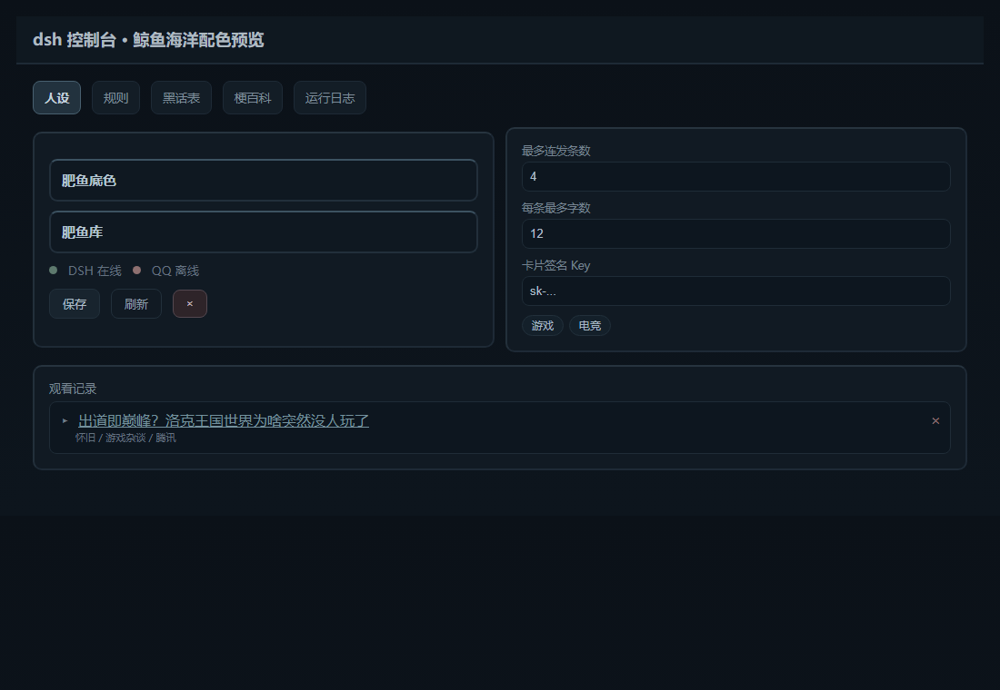

# qfish

qfish 是 DeepSeek Harness 的插件。接上 QQ 之后，就是一只大肥鱼：收发消息、看图、看视频、管群。

它用的模型、会话、工具都来自 DSH，没有另外一套服务。

---

## 它是什么

- 跑在 **DeepSeek Harness** 里的 QQ 机器人插件，通过 **OneBot v11 / NapCat** 收发消息；
- 群里和私聊是同一个人设、同一份记忆；
- 什么时候说话、要不要看视频，由模型判断，不是关键词触发。

---

## 三件核心的事

### 一、看视频

你发链接或卡片，它会去 B 站取这些东西：

- 字幕，带时间戳；
- 画面，按分钟切成九宫格，一帧一帧看；
- 弹幕和热评；
- 太长会直接说太长，不装看过；
- 看完写摘要和感想，存进观看记录。

这是插件里最花功夫的一块，也是它和「只念标题」最大的区别。

### 二、记忆

- 按人存，不是一份大杂烩；
- 记满了会自己压成更短的一条；
- 会话聊长了会轮换，旧上下文压成摘要带进新会话；
- 群聊和私聊共用同一份记忆。

### 三、分寸

- 群里有接话概率，不是有问必答；
- 被叫名字、被 @，一定会应；
- 被嫌吵可以让它闭嘴，只对那个人生效；
- 熟人和生人，接话的积极程度不一样。

---

## 功能清单

### 人格与说话

- **人设文件**：性格写在 markdown 里，改文件就换人。
- **语言模仿**：会学群里人的说法和句式。
- **黑话表**：群里的黑话看得懂，被骂时也会用。
- **禁词表**：回复里出现的词自动删掉。
- **梗百科**：查梗、加梗，聊天时能用上。

### 记忆与会话

- **长期记忆**：按人存，有上限，满了自动压缩。
- **会话摘要**：轮换时压缩上下文，新会话带着走。
- **群聊缓存**：进群先看最近几句，接得上话。
- **记忆锁定**：重要的那条可以锁住，不被压缩。

### 群聊与私聊行为

- **接话概率**：群里不是每条都回。
- **熟人概率**：认识的人说话，更容易接。
- **闭嘴**：只对某个人静音，不影响别人。
- **被骂反应**：会用黑话回嘴，不是一味道歉。
- **私聊**：话比群里多，记得你的事。

### 社交

- **联系人档案**：名字、称呼、备注。
- **好感度**：会影响语气和态度。
- **认人**：聊久了会主动问怎么称呼。

### 内容工具

- **B 站**：找视频、看视频、发卡片、观看记录。
- **音乐**：网易云 / QQ 音乐卡片。
- **表情包**：收、存、随机发。
- **搜图**：pixiv、booru、以图搜图。
- **联网**：搜索、抓网页正文。

### 管理与运维

- **提醒**：定时提醒。
- **群管理**：禁言、踢人、处理加群和好友申请。
- **发消息**：跨群、私聊、@ 人。
- **服务器命令**：`/dsh` 让机器人跑运维命令，仅后台权限。
- **代理**：走 Clash / HTTP 代理访问外网。
- **贴吧**：配置百度 Cookie。

### DSH 集成

- **右下角入口**：DSH 页面右下角的悬浮按钮，点开就是控制台。
- **控制台**：会话、记忆、社交、观看记录、配置、日志，都在一个页面里。

---

## 装它

**前置**

- DeepSeek Harness
- NapCat（或任意 OneBot v11 实现）
- 一个 QQ 机器人账号

**步骤**

1. 把本仓库放进 DSH 的 profile 依赖（本地路径或 git 地址均可）；
2. 在 NapCat 里开 WebSocket 服务，记下端口和 token；
3. 配好插件的 OneBot 地址；
4. 启动 DSH，扫码登录；
5. 打开控制台，开始调。

**装完之后**

- QQ 里能收到它的回复；
- DSH 右下角会出现它的入口；
- 控制台里能看到会话、记忆、观看记录。

---

## 调它

**控制台里可以调**

- 行为参数：回复条数、每条字数、接话概率、轮换阈值、回复预算；
- 人设文件：直接编辑，保存即生效；
- 社交：联系人、备注、好感度；
- B 站：观看记录、卡片签名、扫码登录；
- 黑话、禁词、梗百科、表情包、提醒。

**默认值（都可以改）**

| 项 | 默认 |
|---|---|
| 一次回复最多条数 | 4 |
| 每条最多字数 | 12 |
| 群聊接话概率 | 5% |
| 每次记忆上限 | 45 条/人 |
| 会话轮换 | 30 轮或 40 万字符 |
| 观看记录 | 50 条 |
| 同一视频缓存 | 10 分钟 |
| 视频时长上限 | 10 分钟 |
| 每小时视频上限 | 20 条 |

**人设**

- 放在 `defaults/persona/`，纯 markdown；
- 多个文件按顺序拼起来；
- 不用重启，改完下一条消息生效。

---

## 它记在哪

数据都在 profile 的数据目录里，纯 JSON / 文本，可以直接看、直接备份。

- 记忆：`memories.json`
- 摘要：`summaries.json`
- 会话索引：`state.json`
- 观看记录：`bili-memory.json`
- 联系人：`contacts.json`
- 黑话 / 禁词 / 梗 / 表情：各自的 json 和目录
- 九宫格缓存：`frames/`（只留最近一批）

**会自动清理**

- 读图会话用完即删；
- 旧会话段轮换后删；
- 临时视频文件抽完帧就删。

---

## 常见问题

**它不回我**

- 群里没 @ 也没叫名字，可能在按概率接话；
- 检查接话概率是不是调得太低；
- 看控制台「运行日志」里有没有报错。

**看视频失败**

- 视频超过时长上限会被拒绝，这是正常的；
- 检查 B 站 Cookie 是否过期；
- 卡片发不出去是签名服务的问题，文字链接仍然可用。

**扫码登不上**

- 二维码有时效，重新生成；
- NapCat 掉线时，控制台会提示重连。

**控制台打不开**

- 确认服务在跑；
- 确认访问地址和端口；
- 页面需要 token，别漏了。

---

## License

见 [LICENSE](LICENSE)。
