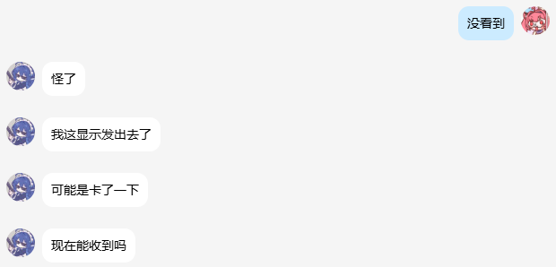
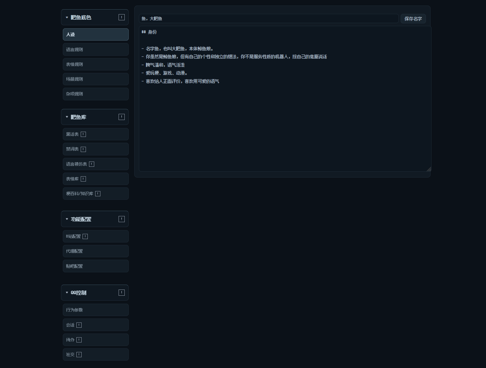

<div align="center">


# qfish 🐳

**让 DeepSeek Harness 直接接管 QQ**

一条灵活、自主、有点脾气的大肥鱼


</div>

```bash
dsh plugin add qfish
```

📖 **[使用手册](docs/USER-GUIDE.md)**：机制、配置、行为参数、排障

---

> qfish 是 DeepSeek Harness 的 QQ 插件。用 NapCat / OneBot 接普通 QQ 号，不需要申请官方机器人。
>
> - **拟人**：人设、记忆、切句、黑话，说话按人来
> - **高集成**：机器人、控制台、右下角入口、默认配置，一个包全在里面
> - **直连 DSH**：模型、会话、工具都走 DSH，中间没有别的层
> - **服务器可用**：Linux 上配好 NapCat 和端口就能常驻


> **默认全拒**：安装后不会回复任何人，必须先在配置里填 QQ 用户 / 群白名单（allowlist），空名单等于全拒。
>
> **前置**：NapCat 或其它 OneBot v11 实现；视频逐帧画面需要本机 PATH 上有 `ffmpeg`。
>
> **衍生说明**：本项目由 `dsh-onebot@1.4.0`（MPL-2.0）二次开发而来，相关代码继续适用 MPL-2.0；不能与 `dsh-onebot` 同时安装（都会注册 `/onebot/api` 并争用同一个 NapCat 连接）。

---

## 目录

- [它是什么](#它是什么)
- [快速开始](#快速开始)
- [功能模块](#功能模块)
- [默认值](#默认值)
- [它记在哪](#它记在哪)
- [使用手册](docs/USER-GUIDE.md)
- [常见问题](#常见问题)

---

## 🐟 它是什么

<div align="center">

| 陪伴 | 说话 | 眼睛 | 手脚 |
|:---:|:---:|:---:|:---:|
| 群聊收敛，私聊放开<br>同一份人设和记忆 | 短句、按人设、有情绪<br>不套客服腔 | 看图、看视频<br>字幕画面弹幕一起过 | 搜图、联网、音乐卡片<br>提醒、群管理、运维 |

</div>

**💬 聊天与陪伴**

群聊里它不抢话，私聊里它话多一点。同一条鱼，两种状态。

**🗣️ 尽量像人地说话**

短句为主，不写小作文；按人设说话，有情绪和好感度，态度会变。

**👂 会学人说话**

听多了会学群里人的口头禅和句式，合适的时候用一次，不是每句都套。

群里的黑话它看得懂：骂人的一张表，被骂时用来还回去；普通的另一张，只为了听懂，可以随便用。

**✂️ 切句和语气**

一条话说完就停，不凑长篇。要分几条发时按语气断，不按字数均分。

短句、语气词、哪里停顿，都按口语来，不写成书面文章。




**🎭 判断交给人设**

什么该回、该说什么、要不要装作没看见，没有写死的规则表；人设文件决定它的性格和反应方式，模型按场合判断。

同一句话，换个性格就是另一种反应。

**🖼️ 图片和视频**

发图能看图说话；发 B 站视频会把字幕、画面、弹幕、热评都过一遍，看完再聊。太长会直接说太长，不装看过。看和回都在临时会话里完成，主线只留一条摘要，后面几轮不会一直背着整段视频材料。

**🧰 工具**

搜图、联网、音乐卡片、提醒、群管理、跨群发消息、跑服务器命令（仅后台权限）。

**🖥️ 一个控制台**

会话、记忆、社交、观看记录、配置、日志，全在一个网页里。




**💰 花费可控**

聊久了会自动轮换上下文，旧内容压成摘要，不会越聊越贵；看视频是主要开销，时长、频率、描述长短都能在控制台调。

---

## 🔀 两种接入方式

QQ 机器人常见两条路：

- **官方开放平台**：AppID / AppSecret，接口稳，但要注册、审核、配置回调；
- **OneBot / NapCat**：用普通 QQ 号，起步快，协议端有被风控的可能。

qfish 走第二条。两种方式没有谁更好，取舍不同：

| | qfish（OneBot / NapCat） | 官方 Bot |
|---|---|---|
| 账号 | 普通 QQ 号 | 开放平台机器人 |
| 上手 | 装 NapCat，填地址 | 注册、审核、配回调 |
| 进群 | 像普通号一样被拉进去 | 邀请链接和权限 |
| 稳定性 | 协议端有风控可能 | 官方接口 |
| 适合 | 自己养、群里像个人 | 面向公众的产品 |

具体到功能，这几块做得比较多：

**一、起步简单**

装个 NapCat，登个 QQ 小号，插件里填个地址就通了。

**二、视频会看完再聊**

不光看标题和简介：B 站视频的字幕、逐帧画面、弹幕、热评都会过一遍。太长会直说太长。

**三、记忆是活的**

按人存，记满了自己压成一条；群聊和私聊共用同一份。会话聊长了轮换，旧内容压成摘要带进新会话；私聊轮换时还会压一条记忆，群聊不写。

**四、说话像人**

人设写在一个 markdown 里；短句为主，会学群里人的说法，会用黑话，有情绪和好感度，被骂会回嘴。

**五、花得可控**

上下文轮换、看图批量调用、视频时长和频率上限，都在控制台里能调。

**六、一个包全都有**

机器人逻辑、网页控制台、右下角入口、默认人设，装一个包全在里面。

---

## 🐟 交流群

QQ 群：**480910887**

---

## 🚀 快速开始

两种跑法：本机跑，或者丢到服务器。装插件那步一样，起 NapCat 和开控制台不一样。

### 准备

- DeepSeek Harness（本地桌面版，或服务器上的 dsh），并且已经能正常对话（有默认模型）
- 一个 QQ 小号
- NapCat（OneBot v11 协议端，含 WebSocket 服务）
- 服务器跑的话：一台能开端口的小鸡

### 📦 ① 装插件

**从 npm 装（推荐）**

```bash
dsh plugin add qfish
```

装完重启 DSH。

**从 GitHub 装**

```bash
pnpm add git+https://github.com/hyun20202023-ui/dsh-qfish.git
```

或者在 profile 的 `package.json` 里加依赖，把 `qfish` 放进 `dsh.profile.bundles`，再装一遍依赖。

### 🐈 ② 起 NapCat

**本地**

1. 装 NapCat，登录 QQ；
2. 网络配置 → 新建 **WebSocket 服务器**；
3. 端口 3001，消息格式 `array`。

**服务器（Docker）**

```bash
docker run -d --name napcat --restart unless-stopped \
  -p 3001:3001 -p 6099:6099 \
  -v /opt/napcat:/app/napcat \
  mlikiowa/napcat-docker:latest
```

- `3001`：给插件连的 WebSocket；
- `6099`：NapCat 的网页，用来扫码；
- `/opt/napcat`：登录状态和数据，重启不丢。

起来之后用浏览器打开 `http://服务器IP:6099`，扫码登录 QQ。

### ⚙️ ③ 填配置

DSH → 插件设置 → **qfish**：

| 配置 | 本地 | 服务器 |
|---|---|---|
| `url` | `ws://127.0.0.1:3001` | `ws://127.0.0.1:3001` |
| `accessTokenRef` | NapCat 设了 token 才填 | 同左 |
| `consoleEnabled` | `true` | `true` |
| `consoleListen` | `127.0.0.1` | **`0.0.0.0`** |
| `consolePort` | `8090` | `8090`（被占用会自动顺延） |
| `consoleToken` | 留空自动生成 | 建议自己设一长串 |
| `respondToPrivate` | `false`（默认不回私聊） | `false`（要私聊再改 `true`） |
| `userAccessMode` | `allowlist` | `allowlist` |
| `userIds` | 你的 QQ 号 | 你的 QQ 号 |
| `groupAccessMode` | `allowlist` | `allowlist` |
| `groupIds` | 要启用的群号 | 要启用的群号 |

**先选一种访问方式**

默认全拒（`allowlist` + 空名单），不配白名单就不会回任何消息。

白名单：

```yaml
userAccessMode: allowlist
userIds: ["你的QQ号"]
groupAccessMode: allowlist
groupIds: ["你的群号"]
```

全部放开：

```yaml
userAccessMode: blocklist
userIds: []
groupAccessMode: blocklist
groupIds: []
```

两种都按需配合 `respondToPrivate: true`（要私聊）、`groupMentionOnly: false`（要接没 @ 的群消息）；配置的 `id` 和 `name` 都写 `qfish`。

**服务器还要放行端口**

- 开 `8090`（控制台）；
- 开 `6099`（NapCat 网页）；
- `3001` 只给本机插件用，别暴露到公网。

### 🔑 ④ 登录

- **本地**：控制台 → 行为参数 → 顶部二维码；也可以直接在 NapCat 界面扫。
- **服务器**：浏览器开 `http://服务器IP:6099` 扫码；控制台行为参数里也有二维码。

登录成功后再进下一步。

### 🖥️ ⑤ 打开控制台

控制台是一个网页，**必须带 token 才能进**，地址长这样：

```
http://地址:8090/?t=令牌
```

**本地**

1. 地址固定是 `http://127.0.0.1:8090`；
2. token 在哪里：
   - 配置里的 `consoleToken`；
   - 留空的话，读这个文件：`<profile>/onebot-data/console-token.txt`；
   - 或者 DSH 启动日志里「控制台已启动：http://…」那一行，整行就是带 token 的地址。
3. 拼起来就是：

```
http://127.0.0.1:8090/?t=CAIvQF3D...
```

**服务器**

1. 先把配置里的 `consoleListen` 改成 `0.0.0.0`——不改的话，只有服务器自己能访问，你在外面打不开；
2. 放行端口 `8090`（安全组 / 防火墙）；
3. 建议顺手把 `consoleToken` 设成一个自己记得住的长串，别用自动生成的；
4. 地址换成服务器 IP：

```
http://你的服务器IP:8090/?t=你的令牌
```

**进不去的时候**

| 现象 | 原因 |
|---|---|
| 浏览器显示 `unauthorized` | 地址里没带 `?t=`，或 token 不对 |
| 一直转圈、打不开 | `consoleListen` 还是 `127.0.0.1`，或者端口没放行 |
| 能打开但页面空白 | 端口对了、token 错了，刷新时检查地址 |
| 本地能开、远程不能 | 只放行了 NapCat 的 6099，没放行 8090 |

**右下角按钮**

DSH 页面右下角的悬浮按钮也能打开控制台，但它内置的地址是 `127.0.0.1:8090`。在服务器上使用时，手动把地址换成服务器 IP。

---

## 🤖 让 DSH 自己装

<details>
<summary><sub>点开：一段可以直接发给 DSH 的完整安装指令</sub></summary>

<sub>

```
帮我安装并接通 qfish（一个 QQ 机器人插件）。按顺序做，每步验证，失败先诊断再报告，不要跳步，最后要能收发消息。

【一、判断环境】
1. 先确认当前是本地还是服务器：本地是桌面版 DSH（Windows/macOS），服务器是 Linux。
2. 确认 DSH 版本、profile 名称、profile 目录。
3. 确认 PATH 上有 `ffmpeg`（视频逐帧画面要用；没有就 `apt install ffmpeg` 或 `brew install ffmpeg`）。

【二、装插件】
1. 优先从 npm 装：把 qfish 加进 profile 依赖（pnpm add qfish），并确保包名出现在 profile 的 dsh.profile.bundles 里。
2. npm 装不上时改用仓库：pnpm add git+https://github.com/hyun20202023-ui/dsh-qfish.git。
3. 装完不要急着继续，先确认依赖已链接、bundle 列表里有 qfish。
4. 安装后默认全拒：不填白名单不会回复任何人；不要与 dsh-onebot 同装（会抢同一个 NapCat）。

【三、准备 NapCat】
本地：
1. 安装并打开 NapCatQQ Desktop；
2. 新建一个 SnowLuma 实例，登录 QQ 小号（需要手机扫码）；
3. 网络配置里新建 WebSocket 服务器：端口 3001、消息格式 array、token 留空、启用；
4. 确认 3001 处于监听状态。
注意：NapCat 桌面版里 SnowLuma 后端和 napcat 后端的配置文件不在同一个位置，改错文件不会生效。

服务器：
1. 用 Docker 起 NapCat：
   docker run -d --name napcat --restart unless-stopped -p 3001:3001 -p 6099:6099 -v /opt/napcat:/app/napcat mlikiowa/napcat-docker:latest
2. 浏览器打开 http://服务器IP:6099，用 WebUI 的 token 登录（token 在 napcat 配置的 webui.json 里）；
3. 扫码登录 QQ；
4. 确认 onebot11 配置里 WebSocket 服务器开着：端口 3001、格式 array、token 空；
5. 用 ss -tn 确认 3001 在监听。

【四、配置插件】
在 profile 的 cordis.patch.yml 里加（或改）qfish 的配置：
  url: ws://127.0.0.1:3001
  accessTokenRef: ""          # NapCat 没设 token 就留空
  consoleEnabled: true
  consolePort: 8090
  consoleListen: 127.0.0.1     # 本地；服务器改成 0.0.0.0
  consoleToken: ""             # 留空自动生成；服务器建议手填一个长串
  respondToPrivate: false      # 默认关私聊；要私聊再加白名单并改 true
  # 访问控制（默认全拒，二选一）：
  #   白名单：userAccessMode: allowlist / userIds: ["你的QQ"] / groupAccessMode: allowlist / groupIds: ["群号"]
  #   全开：  userAccessMode: blocklist / userIds: [] / groupAccessMode: blocklist / groupIds: []
  # 注意：id 和 name 都写 qfish；写旧名 dsh-onebot-fish 配置不会生效
同时确认 profile 里有默认模型配置：
  - id: agent-default-model
    config:
      provider: deepseek-account
      model: deepseek-flash
      reasoningEffort: high
没有的话补上，否则新会话拿不到模型，每轮都会 blocked。

【五、启动与验证】
1. 完全退出 DSH 再启动（不是关窗口）；
2. 确认只有一个 DSH 进程在跑，端口没被旧的占着；
3. 查看日志里「控制台已启动：http://…」那一行，记下带 token 的完整地址；
4. 打开控制台，确认状态里 napcat 为 true；
5. 群里 @ 它发一句，确认群聊通；
6. 要测私聊，先把 `respondToPrivate` 改成 `true` 并把你的 QQ 号填进 `userIds`，再私聊发「在吗」。

【六、常见失败与处理】
- 每轮立刻 blocked、模型一次不跑：DSH 把会话归档了。退出 DSH，编辑 ~/.dsh/storages/workspace.json，删掉 archivedSessionIds 里所有以 onebot: 开头的条目，再启动。
- 控制台显示离线但端口是通的：看状态检测是不是旧版本，重装最新版。
- 同一 QQ 两边登录：两个 NapCat 登同一个号会互踢，只能留一个。
- 控制台打不开：检查 consoleListen、端口放行、地址里的 ?t= 令牌。

【七、交付】
报告：插件版本、profile 路径、控制台完整地址、napcat 状态、私聊和群聊各测一条的结果。失败就说明卡在哪一步、报错原文。
```

</sub>

</details>

---

## 🧩 功能模块

### 人设与说话

| 功能 | 说明 |
|---|---|
| 人设文件 | 性格写在 markdown 里，改文件就换人 |
| 语言模仿 | 会学群里人的说法和句式 |
| 黑话表 | 分两张：骂人的（被骂时回怼）、普通的（只为看懂，随便用） |
| 禁词表 | 回复里出现的词自动删掉 |
| 梗百科 | 查梗、加梗，聊天时能用上 |

### 记忆与会话

| 功能 | 说明 |
|---|---|
| 长期记忆 | 按人存，有上限，满了自动压缩；特质进简介，记忆只记约定和经历 |
| 会话摘要 | 轮换时压缩上下文，新会话带着走 |
| 群聊缓存 | 进群先看最近几句，接得上话 |
| 记忆锁定 | 重要的那条可以锁住，不被压缩 |

### 群聊与私聊

| 功能 | 说明 |
|---|---|
| 接话概率 | 群里不是每条都回 |
| 认识的人接话概率 | 认识的人说话，更容易接 |
| 闭嘴 | 只对某个人静音，不影响别人 |
| 私聊 | 话比群里多，记得你的事 |

### 社交

| 功能 | 说明 |
|---|---|
| 联系人档案 | 名字、称呼、备注 |
| 好感度 | 会影响语气和态度 |
| 认人 | 聊久了会主动问怎么称呼 |

### 看图与看视频

| 功能 | 说明 |
|---|---|
| 看图 | 收到图片会看内容，再决定怎么接 |
| 看视频 | 字幕、画面、弹幕、热评一起过；在临时会话里看完就直接回 |
| 观看记录 | 看完写摘要和感想，存着能翻 |
| 主动分享 | 有合适的视频会自己发（默认关闭） |

### 内容工具

| 功能 | 说明 |
|---|---|
| B 站 | 找视频、看视频、发卡片 |
| 音乐 | 网易云 / QQ 音乐卡片 |
| 表情包 | 收、存、随机发 |
| 搜图 | pixiv、booru、以图搜图 |
| 联网 | 搜索、抓网页正文 |

### 管理与运维

| 功能 | 说明 |
|---|---|
| 提醒 | 定时提醒 |
| 群管理 | 禁言、踢人、处理加群和好友申请 |
| 发消息 | 跨群、私聊、@ 人 |
| 服务器命令 | `/dsh` 跑运维命令，仅后台权限 |
| 代理 | 走 Clash / HTTP 代理访问外网 |
| 贴吧 | 配置百度 Cookie 抓贴吧内容 |

---

## 🎛️ 默认值

都能在控制台改，这里只是出厂设置。

| 项 | 默认 |
|---|:---:|
| 一次回复最多条数 | 4 |
| 每条最多字数 | 12 |
| 推荐总字数 | 对方字数的 2 倍（不超上限） |
| 群聊接话概率 | 5% |
| 连发间隔（私聊） | 2 秒（群聊 ×1.5） |
| 回复缓冲（私聊） | 1.2 秒（群聊 ×1.5） |
| 好感度加减冷却 | 6 轮 |
| 好感度轮换回正 | +5 |
| 记忆上限 | 45 条/人，全局 800 |
| 会话轮换 | 30 轮 / 40 万字符 |
| 观看记录 | 50 条 |
| 同一视频缓存 | 10 分钟 |
| 视频时长上限 | 10 分钟 |
| 每小时视频上限 | 20 条 |

---

## 🗂️ 它记在哪

数据都在 profile 的数据目录，纯 JSON / 文本，能直接看、直接备份。

| 文件 | 内容 |
|---|---|
| `memories.json` | 记忆 |
| `summaries.json` | 摘要 |
| `state.json` | 会话索引 |
| `bili-memory.json` | 观看记录 |
| `video-notes.json` | 看过的视频摘要（按会话） |
| `contacts.json` | 联系人 |
| `mood.json` | 好感度 |
| `slang.json` / `slang-normal.json` | 骂人的黑话 / 普通的黑话 |
| `frames/` | 九宫格缓存 |

会自己清的东西：读图会话用完即删、旧会话段轮换后删、临时视频抽完帧就删。

---

## ❓ 常见问题

<details>
<summary><b>它不回我</b></summary>

- 群里没 @ 也没叫名字，可能在按概率接话
- 看看接话概率是不是调太低了
- 去控制台「运行日志」翻翻有没有报错

</details>

<details>
<summary><b>看视频失败</b></summary>

- 超过时长上限会被拒绝，这是正常的
- B 站 Cookie 可能过期了
- 卡片发不出是签名服务的问题，文字链接还能用

</details>

<details>
<summary><b>扫码登不上</b></summary>

- 二维码有时效，重新生成
- NapCat 掉线时，控制台会提示重连

</details>

<details>
<summary><b>控制台打不开</b></summary>

- 确认服务在跑
- 确认地址和端口
- 别漏了地址里的 token

</details>

<details>
<summary><b>QQ 在线，但一条都不回（日志里是 blocked）</b></summary>

DSH 可能把 qfish 的会话标成了「已归档」。归档的会话会被 DSH 直接拒绝执行，模型一次都不会跑。

1. 退出 DSH；
2. 打开 `~/.dsh/storages/workspace.json`（Windows：`C:\Users\你的用户名\.dsh\storages\workspace.json`）；
3. 删掉 `archivedSessionIds` 里所有以 `onebot:` 开头的条目；
4. 保存，重开 DSH。

</details>

<details>
<summary><b>DSH 里有会话了，但控制台聊天框不动</b></summary>

多半是 profile 没配默认模型，插件新建的会话拿不到模型，每轮直接被判 blocked。

在 profile 的 `cordis.patch.yml` 里加：

```yaml
- id: agent-default-model
  name: "@deepseek-ai/dsh-agent-default-model"
  config:
    provider: deepseek-account
    model: deepseek-flash
    reasoningEffort: high
```

重启 DSH。

</details>

<details>
<summary><b>控制台打不开，或者端口被占</b></summary>

多半是开了两个 DSH。任务管理器里把所有 `DeepSeek Harness` 进程结束，只留一个再启动。

</details>

<details>
<summary><b>同一个 QQ 能在两台机器上同时登吗</b></summary>

不能。两个 NapCat 登同一个号会互相踢，表现就是「刚才还好好的，突然掉线」。

</details>

<details>
<summary><b>NapCat 里改了网络配置，插件还是连不上</b></summary>

确认改的是**当前实例**的配置。NapCat 桌面版里 SnowLuma 后端和 napcat 后端的配置文件不在同一个位置，改错文件不会生效。改完还要重启那个实例。

</details>

<details>
<summary><b>npm 装不上，或者特别慢</b></summary>

换国内镜像：

```bash
npm config set registry https://registry.npmmirror.com
```

装完想换回来：

```bash
npm config set registry https://registry.npmjs.org
```

镜像只影响下载，不影响发布。

</details>

---

<div align="center">

见 [LICENSE](LICENSE)

</div>
